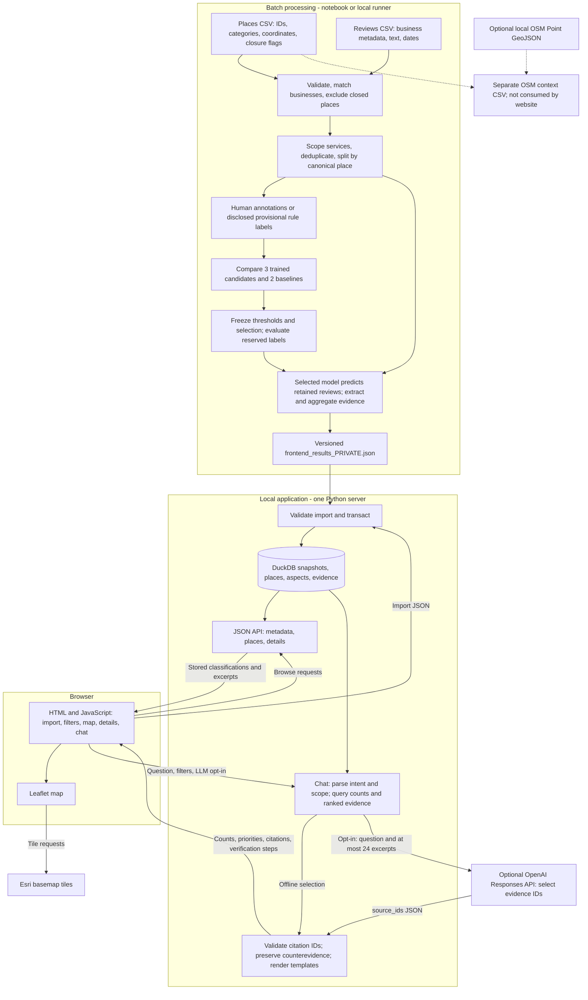
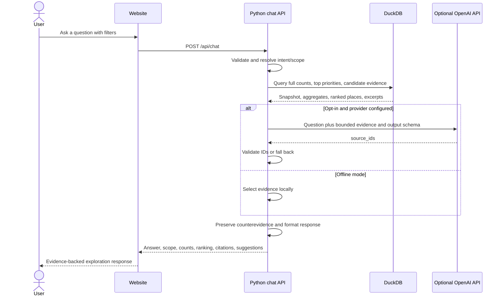

# Access Beyond the Map: system design and complete walkthrough

This document describes the implemented code, inspected November 15, 2026. The project helps advocates and service coordinators inspect **reported access barriers** in reviews of clinics, pharmacies and grocery stores. The output supports manual verification; it does not certify a location's current accessibility.

The system has two execution stages: **batch analysis** through the LLM runner or notebook and **interactive exploration** in a local website. Classification happens in the batch stage. Opening the map, changing filters or asking the chatbot a question does not retrain or invoke the review classifiers. During interactive exploration, the only optional model call is the chatbot's evidence selector; the batch LLM runner makes separate API calls beforehand.

## Current classified snapshot: direct LLM review classification

The active local and bundled snapshot now uses `gpt-5.6-terra` to classify the
same 1,868 historically retained reviews across all five accessibility aspects.
`scripts/classify_reviews_llm.py` recovers that cohort, applies a documented
rubric through structured output, and exports 79 locations with 1,303 evidence
excerpts. The model selects numbered passages; exact quotations and per-place
aggregates are built locally. This uses no keyword training labels and does not
rerun the new matcher. Independent human evaluation remains pending.

The flow is **raw Reviews + historical matched cohort → direct LLM review
classification → local location/aspect aggregation → versioned JSON → DuckDB
→ Python API → list/map/evidence**. The original notebook workflow described
below remains available for TF-IDF baselines and model research. The chatbot is
a separate optional evidence-selection feature. See
[LLM classification](LLM_CLASSIFICATION.md) for commands and output provenance.

## 1. System design diagram

The editable Mermaid source is [diagrams/system-design.mmd](diagrams/system-design.mmd). Solid arrows show the main implemented paths. Dashed arrows show a separate optional enrichment export.



The JSON export is the boundary between research and the product. The website can import a successful notebook run without installing the training dependencies. DuckDB stores immutable result snapshots and an active-snapshot pointer. A single Python process serves both the static frontend and the JSON API, avoiding a separate frontend build or application server service.

The OpenAI path is optional and explicitly enabled by the user. In the local app, testers can enter their own key through a password form; it is submitted to the loopback Python server and immediately cleared from the form. The server keeps it only in memory for that run and never returns it in responses or stores it in DuckDB. Environment credentials remain an alternative. The map's external dependency is Esri basemap tiles; stored place coordinates and classification markers come from the local app.

## 2. What happens before someone opens the website

| Step | Input | Processing | Output |
|---|---|---|---|
| Acquire | Full organizer Places and Reviews CSVs | Reuse schema-valid cached files or download; reject HTML/error pages; record source checksums | Validated sources and source manifest |
| Select fields | Source columns | Read analysis/business metadata, excluding reviewer identity fields | Places and Reviews analysis frames |
| Resolve businesses | Place IDs, alternate IDs, business names and full addresses | Exact ID first; unique CID/FID or supported Google URL CID next; unique normalized name/full-address fallback; reject ambiguous/conflicting fallbacks | Source-to-canonical place crosswalk with method/status |
| Apply closures | Canonical Places and closure flags | Resolve against all known Places, then exclude explicit permanent closures, retaining temporary/unknown status | Joined reviews for eligible locations |
| Scope services | Joined Places category/all-category text | Category rules assign pharmacy, grocery, clinic or other; retain first three | Target-service review frame |
| Deduplicate | Review text | Normalize case/punctuation/whitespace; remove exact duplicates; use MinHash candidates and a Jaccard check for near duplicates | Retained unique review text |
| Split | Canonical place IDs | Grouped approximately 70/15/15 train/validation/test split, fixed seed | Saved split manifest |
| Label | Review text and optional human label files | Export annotation queues; validate completed human records; otherwise disclose provisional rules | Five aspect-state targets per development review |
| Fit and select | Train text/targets; validation text/targets | Fit candidate models; tune supported thresholds; compare validation F1 | Model artifacts, thresholds, comparison winner, explicitly selected explorer model |
| Evaluate | Frozen decisions and reserved human test labels | Compute baseline comparisons, per-aspect and subgroup metrics, confusion matrices and uncertainty | Evaluation artifacts, or an explicit blocked status |
| Export predictions | Selected model and all retained review text | Predict states, extract evidence, aggregate by place/aspect | Frontend JSON, verification queue and reproducibility artifacts |

**Matching details.** A review's source place ID remains part of its stable record identity. The canonical matched place ID controls grouping, aggregation and train/test separation. A known closed place cannot be reassigned to an open business using an alternate ID. Fallback matches are auditable hypotheses, not manually verified truth. The crosswalk is kept as a private notebook artifact; the current frontend shows canonical locations rather than a per-match adjudication screen.

**Filtering details.** `scripts/compare_matching.py` separately compares primary categories, all category fields and a broader essential-service policy. This last option changes the service scope; the audit does not silently apply it to notebook training. Compare like denominators: raw matching coverage, coverage after closures, target-service rows and deduplicated rows are different measures. This project does not currently impose a geographic boundary polygon merely because the original challenge discusses the Bay Area.

**Label details.** Each review needs five aspect labels. Real human records require `record_id`, `aspect`, `state`, `evidence`, `annotator_id`, `provenance=human` and adjudication. Mentioned aspects require an exact evidence substring. Incomplete records are excluded. At least ten completed development reviews in each of train and validation are required by the current code to use human development labels; this is an implementation gate, not proof of statistical adequacy. Otherwise training uses explicitly provisional keyword labels. Test labels are handled after selection. Synthetic mode uses generated known labels strictly for software tests.

## 3. Exactly what the classification models receive and return

The task is **multiple aspects, one state per aspect**. A review can discuss several aspects, but each aspect gets one of four states.

| Axis | Fixed order used in model arrays |
|---|---|
| Aspects | `physical`, `sensory`, `language`, `financial`, `time` |
| States | `no_mention`, `barrier_reported`, `positive_access`, `unclear_or_mixed` |

For a batch of `N` reviews, inference produces scores shaped **`N × 5 × 4`**. Decoding produces states shaped **`N × 5`**. Classifier probabilities are uncalibrated; keyword and majority outputs are deterministic 0/1 scores. They are not verified probabilities that a business has a current barrier.

All trained candidates receive **review text** as their predictive feature input. Place category, coordinates and service group support filtering, maps and evaluation slices; they are not fed into the classifiers as predictive features. Training additionally receives the five aspect-state labels. Each candidate fits an independent classifier per aspect, sharing its text feature representation across aspects.

| Candidate | Training input / transformation | Inference input | Output / purpose |
|---|---|---|---|
| `keywords` | No fitting; aspect terms plus negative, positive and mixed-expression rules | Review text | Four-state one-hot scores per aspect; simple baseline and provisional-label source |
| `majority` | Learn most frequent training state per aspect; implementation fits a vectorizer but the dummy estimator ignores text features | Same review-text interface | Constant majority-state scores per aspect; class-imbalance baseline |
| `tfidf_word` | Word unigrams/bigrams, sublinear TF-IDF, up to 40,000 features; balanced logistic regression per aspect | Review text transformed by training vocabulary | Four-state probability scores; default explorer candidate |
| `tfidf_word_char` | Word features plus character-within-word 3–5-grams, each feature branch capped at 40,000; balanced logistic regression | Review text transformed by the two fitted feature branches | Same score tensor; alternative wording/spelling representation |
| `tfidf_nb` | Word TF-IDF features; Multinomial Naive Bayes with `alpha=1.0` per aspect | Review text transformed by training vocabulary | Same score tensor; distinct classifier family |

If an aspect has only one training state, the implementation uses that constant state instead of fitting a classifier. A constant `no_mention` output means the aspect is unsupported by training variation, not that the locations are accessible.

**Thresholds and selection.** For each trained candidate/aspect, validation tries barrier thresholds from 0.20 to 0.80 in 0.05 increments and selects the best barrier F1. No validation positives sets the threshold to 1.01, disabling barrier flags for that aspect. Keyword and majority baselines use 0.5. Decoding first picks the strongest non-barrier state, then replaces it with `barrier_reported` if the barrier score crosses the threshold.

The comparison winner maximizes validation barrier macro-F1. `FRONTEND_MODEL` independently chooses the exported model: `tfidf_word` by default, another trained candidate, or `validation_winner`. The selected model is not automatically an ensemble. Test metrics compare all five candidates when independent test labels exist. The exported map includes predictions for the entire retained dataset, including training locations; map contents therefore are not a held-out accuracy result.

### A concrete example

Consider this invented review: “The entrance has stairs, but staff showed me a side ramp.” A classifier receives that text and returns four scores for each of the five aspects. Suppose its physical scores are `[0.02, 0.25, 0.18, 0.55]` and the frozen barrier threshold is 0.50. Decoding returns `unclear_or_mixed` for physical access. These numbers illustrate the interface; they are not measured results.

The evidence extractor selects the first sentence containing an aspect keyword; if no such sentence exists for a predicted mention, it returns the full review. Extraction is deterministic, not an LLM span detector. The exported evidence includes the record ID, canonical place ID, aspect, state, selected-state score, barrier score, text and date.

## 4. How review predictions become map classifications

For every place and aspect, the notebook counts barrier, positive and unclear/mixed reports, retaining the sampled-review denominator. No-mention reviews contribute to that denominator but their text is not exported as evidence.

| Evidence counts | Place/aspect status |
|---|---|
| Any mixed report, or both barrier and positive reports | `conflicting_or_unclear` |
| Barrier reports with neither of the conditions above | `reported_barrier` |
| Positive reports only | `positive_evidence` |
| No mentions | `insufficient_evidence` |

These statuses describe sampled text. A lack of reviews, unavailable accommodations or omitted aspects must not be interpreted as a verified positive result. Locations with no retained matched target-service reviews are absent from the export, so this is not a complete inventory of essential services.

The batch stage also exports `verification_queue_PRIVATE.csv` for places/aspects with barrier or uncertain reports, sorted by barrier count then recency. The website chatbot uses a separate fixed ranking described below. Neither is an independently validated severity score.

## 5. The export and database contracts

`frontend_results_PRIVATE.json` has `schema_version: 1` and four main sections:

| Section | Fields and meaning |
|---|---|
| `dataset` | Mode, generation time, selected model, label provenance, evaluation status, source manifest, model selection and metrics |
| `places` | Canonical ID, name, service, address, coordinates, closure status and sampled review count |
| `aspects` | Five records per place: aspect, counts, computed status, dates and verification question |
| `evidence` | Mentioned-aspect records: IDs, state, text, date, selected-state score and barrier score |

Imports validate and whitelist fields, require unique IDs and complete aspect summaries, check count consistency and evidence references, and reject nonfinite numeric values. The canonical validated JSON is hashed into a snapshot ID. A transaction writes `snapshots`, `places`, `place_aspects` and `evidence`, then switches `settings.active_snapshot`. Failed imports roll back. Reimporting the same validated content is idempotent. Old snapshots remain available.

The database also retains `work_items` and related APIs for compatibility. The current single-page interface has no work-item editing screen; chatbot priorities and notebook queue exports are the visible verification aids. Reviewer identity columns are omitted, but free-text excerpts may still contain personal information and require review before sharing.

## 6. What happens when someone uses the website

1. **Start the server.** `python3 scripts/launch_app.py` creates/reuses `.venv`, installs only app dependencies and runs `python -m access_app serve --bundled` on loopback. The included existing real snapshot (79 mapped locations, 1,868 retained reviews summarized, 365 excerpts) seeds an empty database. Existing results are preserved. HTML, CSS, vendored Leaflet JavaScript and the JSON API come from one Python process. Explicit `--demo` seeds four fictional locations instead; serving without either seed option leaves an empty database at the import prompt.
2. **Load the page.** JavaScript requests `/api/metadata` to display dataset mode and coverage and `/api/chat/config` to determine whether optional LLM selection is available. The latter reports availability/model, never the key. The local-only password form can POST a key and model to `/api/chat/config`, or clear them for offline mode. Saving makes no OpenAI request, and the user must separately select the LLM checkbox before asking a question.
3. **Load saved results.** The launcher seeds the bundled snapshot into an empty database. To replace it, stop the app, use the command-line importer and restart. Imported results do not initiate training. The backend `/api/import` endpoint remains available for programmatic imports.
4. **Fetch the list and map.** Two parallel `/api/places` requests use the same service, aspect, search, classification and sort filters. The list requests 20 rows per page; the map requests the first 500 matching rows. SQL queries stored classifications. Search matches location names/addresses, not semantic review content.
5. **Render the map.** Leaflet draws stored coordinates and classification colors over Esri tiles. Missing coordinates remain usable in the list. Network tile failure does not remove stored evidence.
6. **Select a location.** `/api/places/{place_id}?aspect=...` returns location metadata, all five aspect summaries, and up to 50 exported excerpts for the selected aspect, ordered by date. The UI shows the returned count against the available total. Display dates use UTC.
7. **Change a filter.** The list/map/detail requests repeat. Frontend request-version checks prevent a slower response from an earlier filter request overwriting a later result. Browse requests independently resolve the active database snapshot; the chat response has its own consistent snapshot scope.
8. **Ask a question.** `/api/chat` runs the retrieval and optional evidence-selection process below. The returned response records its scope and snapshot, so a later filter change does not retroactively change the answer.

The notebook has its own interactive Folium/widget view. The website is a separate Leaflet-based product view with fewer controls; the notebook's recency/confidence widgets are not website filters.

## 7. Chatbot: request, retrieval, optional model, response

Example request, using invented intent rather than actual findings:

```json
{
  "question": "Which clinics have the most language barriers?",
  "aspect": "physical",
  "service": "all",
  "search": "",
  "place_id": "",
  "use_llm": false
}
```

The server validates the request, then applies these steps:

1. **Interpret scope and intent using rules.** Recognizing a single explicit aspect/service in the question overrides the corresponding explorer default; here the scope becomes `language` + `clinic`. It discloses the override. Intent can be reliability, verification, ranking, aggregate, evidence or unsupported. This parser is regex-based, not an LLM. Questions are independent; history is neither sent nor persisted. Complex comparisons, multi-aspect questions and follow-up references are not fully understood. Ranking requests currently always use descending barrier counts, even if wording asks for the “least.”
2. **Freeze the active snapshot for the query.** Under the database lock, apply service, aspect, search and optional selected-place filters. Chat includes all classifications so positive and uncertain evidence is not hidden by an explorer status filter.
3. **Calculate aggregates in SQL.** Count all matching locations and sampled reviews, with barrier/positive/mixed totals and insufficient-evidence locations. These totals are computed across the full scope, not only the displayed excerpts or top five places.
4. **Rank verification priorities in SQL.** Return up to five places ordered by barrier count descending, mixed count descending, name, then place ID. Volume biases this ranking. It is independent of the question's lexical relevance and the LLM.
5. **Retrieve candidate excerpts.** Take up to twelve unique question tokens consisting of at least four ASCII letters. Score excerpts by substring matches, then sort by date and record ID. Retrieve 22 candidates and reserve up to two additional representatives for positive and mixed evidence across the full scope. Each excerpt is capped at 1,200 characters. Assign temporary response-local IDs `E1`, `E2`, etc.; retain permanent record/place IDs alongside them.
6. **Choose evidence.** Offline mode takes the first eight candidates. With explicit opt-in and configured provider/model/key, the OpenAI Responses API selects up to eight allowed candidate IDs. Provider failures, invalid IDs, incomplete/oversized output and excess concurrency revert to offline retrieval. Available positive and mixed counterevidence is appended if omitted, so displayed citations may total up to ten.
7. **Construct the response locally.** Python formats the intent-specific answer, counts, ranking explanation, quoted citations and curated aspect-specific verification steps. The LLM supplies no displayed factual prose. The frontend escapes text and displays provenance, scope, mode and limitations.



### Exact optional LLM input/output boundary

**Input:** the user question plus at most 24 candidate records, each containing an ID, permanent record ID, place ID/name, predicted state, excerpt, review date and retrieval relevance. The request includes instructions treating all question/review content as untrusted and a strict JSON schema. It sends no model training dataset, SQL tools, API key in the payload body or conversation history. Business names and excerpt text are transmitted; names removed from dedicated reviewer fields do not guarantee the text is anonymous.

**Output:** only a JSON object such as:

```json
{"source_ids": ["E2", "E5", "E1"]}
```

IDs must belong to the supplied candidate set. The server deduplicates the selection and retains counterevidence. The provider has no authority to change counts, predictions, location order or verification instructions. Calls use a 20-second timeout, 500 output-token limit, 128 KiB response limit and at most two concurrent provider calls. `store:false` is requested; this is not a guarantee about the provider's retention policies.

**Website response:** `answer`, `intent`, `mode`, `provider_note`, `notice`, `snapshot_id`, `dataset`, `scope`, `aggregate` (reference `A1`), `ranking`, `ranking_method`, `citations`, `suggestions` and `context_note`. This is an extractive evidence assistant with templated explanations, not an unrestricted generative chatbot.

## 8. Optional data and operational boundaries

- **OpenStreetMap:** the local comparison CLI can ingest Point GeoJSON, require a unique exact normalized name within at most 50 metres, and export wheelchair/opening-hours context with source, retrieval date and ODbL attribution. The context CSV is not yet consumed by the notebook models, website or chatbot. Missing tags remain unknown. No real OSM enrichment coverage has been measured.
- **Census:** area-level disability/language/income context is a possible extension, not an implemented component.
- **Reviews-only adapter:** an explicitly partial alternative exists for sparse review-side business metadata. It must not be confused with the two-source modeling pipeline. The frontend displays its source-mode warning when imported.
- **Hosting:** the default is a local loopback server with origin/Host checks and bounded imports. There is no authenticated multi-user hosting layer or background retraining service. One server process owns DuckDB writes.
- **Secrets:** server environment variables configure the provider. The app does not automatically load `.env`; the optional live-test script supports an explicit env-file argument. Keys do not belong in browser JavaScript or Git.

## 9. Verification status and practical interpretation

The last complete software verification passed **39 tests**, covering notebook/model/annotation invariants, crosswalk conflicts, closure safety, OSM fixture matching, imports, HTTP endpoints, chat scope, counterevidence and mocked provider failure paths. JavaScript syntax and diff checks passed. These tests establish software behavior, not accessibility accuracy.

The prior repository documented 79 mapped locations, 1,868 retained reviews and 365 aspect excerpts in its earlier full-data run. The updated code has not regenerated that run: Places is quota-blocked in this session, although all 213,536 Reviews rows were obtained and profiled. The alternative matcher's real coverage gain remains unmeasured. Human-labeled independent evaluation remains pending; no improvement over the keyword baseline is claimed. Live LLM tests were explicitly deferred by the user. Visual browser verification was not completed because browser origin approval was declined.

## 10. Where each responsibility lives

| Source | Responsibility |
|---|---|
| [Notebook](../Access_Beyond_the_Map.ipynb), sections 2–9 | Acquisition, join, labels, model fitting/selection/evaluation, predictions and export |
| [Local runner](../scripts/run_real_notebook.py) | Execute actual notebook cells and optionally import successful output |
| [Matching](../access_app/matching.py), [comparison CLI](../scripts/compare_matching.py) | Conservative entity resolution, coverage/filter audits, optional OSM context; notebook embeds the matching helper for standalone Colab use |
| [Schema](../access_app/schema.py) | Import validation and status definitions |
| [Database](../access_app/database.py) | Snapshot storage, parameterized queries, compatibility work items |
| [Server](../access_app/server.py), [entry point](../access_app/__main__.py) | HTTP routes, static assets, local startup/import |
| [Frontend](../access_app/static/app.js), [HTML](../access_app/static/index.html) | Filters, list/map/details and chat rendering |
| [Chat](../access_app/chat.py) | Intent/scope, SQL aggregation/ranking, evidence retrieval, optional LLM selection and templated answer |
| [Live smoke test](../scripts/test_live_llm.py) | Two opt-in calls using fictional evidence; never counts fallback as live success |

For runnable setup, see the [README](../README.md), [improvement report](../IMPROVEMENTS.md) and [evidence assistant configuration](evidence-assistant.md).
